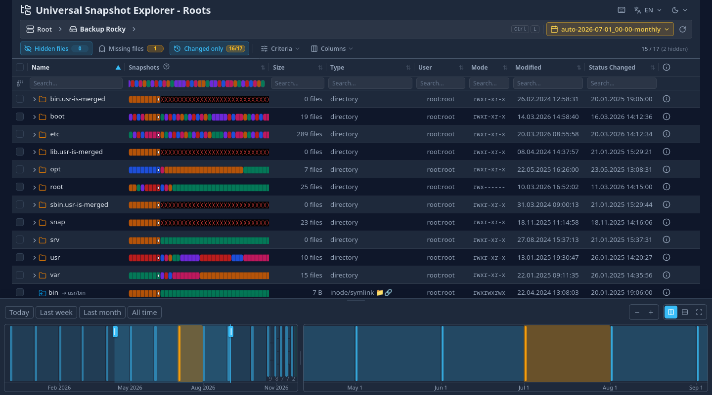
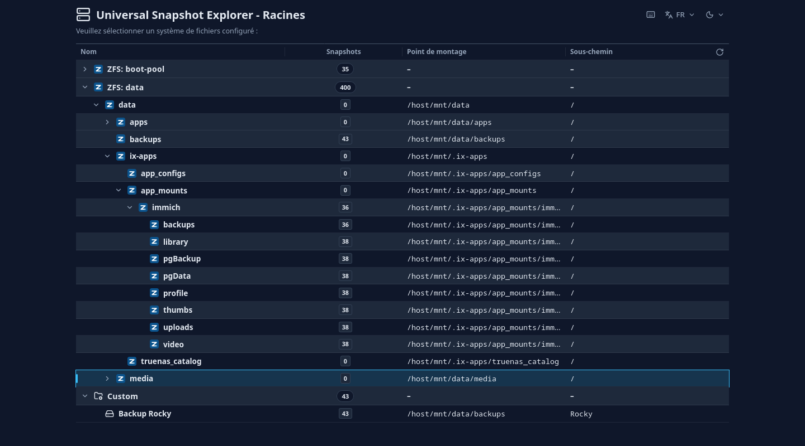
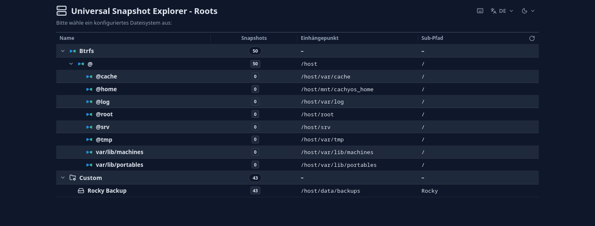
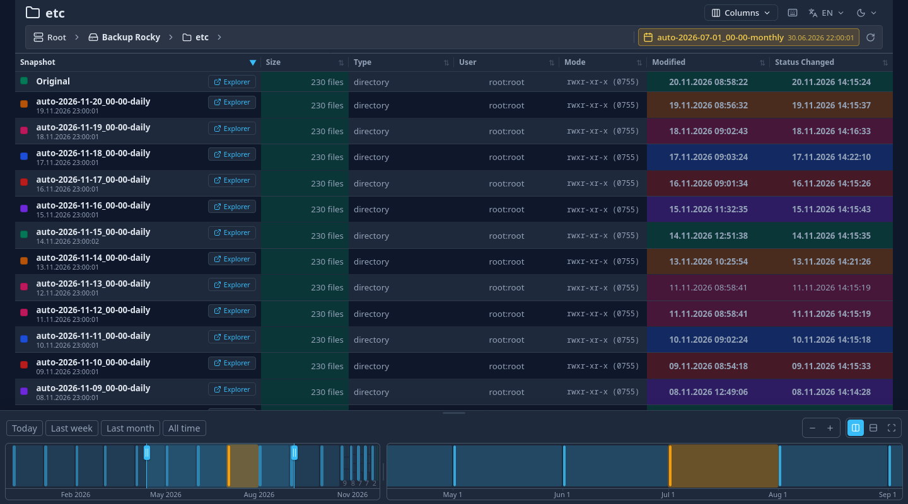
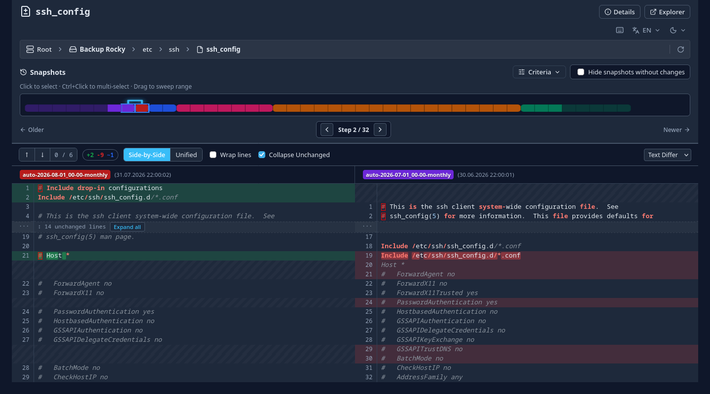

# Universal Snapshot Explorer (USE)

[](https://github.com/NicolasGoeddel/zfs-snapshot-explorer/actions/workflows/ci.yml)
[](#testing--code-quality)
[](https://github.com/detachhead/basedpyright)
[](https://github.com/astral-sh/ruff)
[](https://www.python.org/)
[](https://github.com/NicolasGoeddel/zfs-snapshot-explorer/pkgs/container/universal-snapshot-explorer)
[](https://github.com/NicolasGoeddel/zfs-snapshot-explorer/blob/main/LICENSE)

I started this project last year for the following reason: On my TrueNAS server, I had a ZFS system full of backups and snapshots, and it was just way too complicated to figure out what had changed between the snapshots. Searching through the various `.zfs/snapshot` directories or checking individual folders in multiple tabs quickly becomes tedious, especially when you’re trying to figure out when a file was modified, moved, or deleted.

Since I’ve had over 15 years of experience with Python, I naturally built the backend with it. Frontend development, however, has never really been my thing. But jQuery and Vanilla JavaScript are fine, so I started with those. Also, I really don’t like huge frameworks with npm and the like and their endless dependency trees, so I deliberately kept it completely free of Node and other build toolchains.

As AI coding assistants became increasingly more powerful, I began to bring them in under strict supervision to migrate the front end to more modern standards that I’m not familiar with, and, building on that foundation, to develop additional new features, such as the interactive timeline, the N-way file comparison, the enforcement of POSIX ACLs, and significant improvements to UI performance.

---

## ✨ Key Features

* **📊 Interactive Dual-Timeline & Snapshot Bars:** A sticky dual-timeline panel lets you pan and zoom across your snapshot history with density-aware grouping. Each file and folder row also displays an accessible, colorblind-friendly SVG pill bar indicating creations, modifications, deletions, and static periods (sorted right-to-left from recent to old), with configurable change criteria (`size`, `mode`, `uid`, `gid`, `mtime`, etc.).
* **⚡ Streamed UI & In-Place Folder Navigation:** Switches folders via partial HTML updates without full page reloads, streams an immediate skeleton shell so directory rows are interactive right away while snapshot bars load asynchronously, and serves CSS-mask icons alongside bundled, minified, and GZip-compressed assets.
* **🗂️ Pluggable Multi-Filesystem Support:** Native support for **OpenZFS** (`.zfs/snapshot` and ZFS CLI auto-discovery via `/dev/zfs`), **Btrfs** subvolumes (including **Snapper** `info.xml` layouts), **CephFS** (`.snap`), and generic POSIX snapshot directories.
* **🌐 Boundary & Mount Discovery:** Automatically detects nested mount points and sub-datasets via `/proc/mounts`, rendering dedicated per-dataset snapshot timelines in table rows and breadcrumbs, organized hierarchically in the Roots Dashboard.
* **🛡️ POSIX ACL & Impersonation Support:** Optional read-only enforcement of real filesystem POSIX ACLs (`system.posix_acl_access`), authenticating users via trusted reverse-proxy HTTP headers (e.g., `Remote-User`) or static `impersonate_users` lists while respecting directory traversal and group masks.
* **📦 Multi-Selection & Streaming ZIP Downloads:** Tri-state hierarchical folder checkboxes with `Shift+Space` range selection and on-the-fly streaming ZIP downloads with zero temporary disk files (respecting ACL restrictions).
* **🔍 Instant Audit, Column Filters & Custom Layout:**
  * **Column Filters:** Search per column with text/wildcards, size ranges (`5mb..10mb`), octal/symbolic mode masks (`700`, `g:x`), and relative dates (`today`).
  * **Audit Toggles:** Filter by **Changed only**, **Missing files**, and **Hidden files** (`.*`), plus toggleable and resizable table columns persisted in browser storage.
* **⚖️ Modular N-Way File Differ:** Unified diffing engine designed to compare files across snapshots, shipping with a side-by-side `TextDiffer` plugin.
* **⌨️ Full Keyboard Navigation & Typeahead Search:**
  * Live typeahead HUD (`A`–`Z`, `0`–`9`) to jump straight to matching entries.
  * `↑` / `↓` to move between rows, `→` / `←` to expand/collapse or navigate up, `Enter` to open or download, `Space` / `Shift+Space` to select, `i` for file details, `Ctrl+L` / `Cmd+L` for the breadcrumb path bar, `Shift+R` to refresh caches, and `h` / `?` for the shortcut cheat sheet.
* **📋 Deep File Details & Clean URLs:** Compare file sizes, MIME types, POSIX permissions, ownership (resolved via host or snapshot-relative `/etc/passwd` and `/etc/group`), and timestamps across snapshots using unambiguous `/-/` dataset-to-path URLs (`/list/pool/dataset/-/sub/folder`).
* **🔒 Safe, Read-Only & Localized:** Runs completely read-only (`:ro`) with zero database overhead, automatic dark/light theme detection (`prefers-color-scheme`), and native **English**, **German**, and **French** localization.

---

## 🎯 Use Cases

1. **Self-Service File Recovery for Teams & Homelabs:** Let users easily locate and download previous versions of their documents without needing SSH access or bothering system administrators.
2. **Forensic Audit & Incident Response:** Instantly pinpoint the exact snapshot where a ransomware attack, faulty migration script, or unintended deletion took place.
3. **Version History for Large Assets (Video, 3D, Audio, CAD):** A "Git-like" visual history browser for large binary assets where traditional version control systems struggle.

---

## 📸 Screenshots

### Explorer View (Multi-Snapshot Timeline)


### Roots Dashboard (Hierarchical Overview)
<p align="center">
  
</p>
<p align="center">
  
</p>

### File Details & Version History


### N-Way File Differ (Text Comparison)


---

## 🚀 Quick Start with Docker & TrueNAS Scale

### 1. `docker-compose.yaml`

Run the container with `/dev/zfs` device passthrough and mount the host filesystem root to `/host` with `rslave` propagation for dynamic ZFS snapshot automounts:

```yaml
services:
  universal-snapshot-explorer:
    image: ghcr.io/nicolasgoeddel/universal-snapshot-explorer:latest
    container_name: universal-snapshot-explorer
    restart: unless-stopped
    ports:
      - "8090:8080"

    # Privileged flags (privileged, security_opt, cap_add, devices) are ONLY required if you
    # want to query ZFS metadata via ZFS CLI commands (ZfsCliSnapshotProvider).
    # You can completely omit these if you run in unprivileged User-Space fallback mode
    # (FilesystemSnapshotProvider), which discovers snapshots by scanning .zfs/snapshot dirs.
    privileged: true
    security_opt:
      - apparmor:unconfined
    cap_add:
      - SYS_ADMIN
    devices:
      - /dev/zfs:/dev/zfs

    volumes:
      # Read-only access to host root. 'rslave' propagation is needed to dynamically propagate
      # ZFS auto-mounted snapshots from host to container. Use simple ':ro' for static mounts.
      - /:/host:ro,rslave
      # Application configuration file
      - ./config.yaml:/app/config.yaml:ro

    environment:
      - PYTHONUNBUFFERED=1
```

### 2. `docker run`

The exact same setup as a single `docker run` command:

```sh
docker run -d --name universal-snapshot-explorer --restart unless-stopped -p 8090:8080 --privileged --security-opt apparmor=unconfined --cap-add SYS_ADMIN --device /dev/zfs:/dev/zfs -v /:/host:ro,rslave -v "$PWD/config.yaml:/app/config.yaml:ro" -e PYTHONUNBUFFERED=1 ghcr.io/nicolasgoeddel/universal-snapshot-explorer:latest
```

### 3. `config.yaml`

```yaml
# Global OpenZFS Auto-Discovery Configuration
zfs:
  # Automatically discover all mounted ZFS datasets on the host (scanning for .zfs/snapshot directories)
  auto_discover: true

  # Prefix where the host filesystem root is mounted in the container
  mount_prefix: "/host"

  # Glob patterns for datasets to ignore during auto-discovery
  exclude_datasets:
    - "*/.system*"
    - "*/ix-applications*"
    - "*/docker*"
    - "*/custom-apps*"

  # Default host user/group resolution files to map UIDs/GIDs to usernames/groupnames.
  # If omitted (or set to null), no UID/GID translation takes place, and raw numbers are displayed.
  default_user_map: "/host/etc/passwd"
  default_group_map: "/host/etc/group"

  # Regex patterns to parse timestamps from snapshot directory names in fallback/filesystem mode.
  # Supports datetime directives (like %Y, %m, %d, %H, %M, %S) or wildcards (like {year}, {month}).
  # Necessary for sorting snapshots chronologically if ZFS CLI metadata is unavailable.
  snapshot_patterns:
    - "auto-%Y-%m-%d-%H%M%S"
    - "periodic-%Y-%m-%d-%H%M%S"

# Global Btrfs & Snapper Auto-Discovery Configuration
btrfs:
  # Automatically discover all active Btrfs subvolumes containing .snapshots directories
  auto_discover: true

  # Prefix where the host filesystem root is mounted in the container
  mount_prefix: "/host"

  # Glob patterns for Btrfs paths to exclude from auto-discovery
  exclude_paths:
    - "/var/lib/docker/*"
    - "/var/lib/containers/*"
    - "*/tmp*"

  default_user_map: "/host/etc/passwd"
  default_group_map: "/host/etc/group"

# Optional: Manually define custom roots, sub-paths, or non-discovered backup partitions
roots:
  # Example 1: ZFS backup dataset with nested sub-path
  Backup Rocky:
    # Absolute path to the dataset root directory (must contain the .zfs folder)
    root_path: /host/mnt/data/backups

    # Subfolder inside the dataset root. Useful if the dataset does daily snapshots at
    # the root level but contains nested home folders or root partition mirrors (like 'Rocky')
    sub_path: Rocky

    # Explicit filesystem type: "zfs", "btrfs", or "generic"
    filesystem_type: zfs

    # Relative path (e.g. 'etc/passwd'): dynamically resolved from the currently active snapshot!
    # Absolute path (e.g. '/host/etc/passwd'): statically resolved from the host filesystem.
    # If omitted, falls back to raw numerical UIDs/GIDs for files inside this root.
    user_map: etc/passwd
    group_map: etc/group

    # Snapshot patterns specifically for this root
    snapshot_patterns:
      - "rocky-backup-%Y-%m-%d"

  # Example 2: Btrfs root volume with Snapper snapshot layout
  System Root:
    root_path: /host
    sub_path: ""
    filesystem_type: btrfs
    user_map: etc/passwd
    group_map: etc/group

# Optional: Authenticated access with POSIX ACL enforcement (disabled by default)
# security:
#   enabled: true
#   trusted_user_header: Remote-User
#   # Optional: For standalone setups without an auth proxy, impersonate the union of these users
#   impersonate_users:
#     - alice
#     - bob

# Log verbosity level. Supported values: debug, info, warning, error, critical
loglevel: info
```

> [!TIP]
> For a detailed breakdown of all configuration parameters, filesystem providers, path resolution mechanics (e.g. `btrbk` setup, custom snapshot directories), and dynamic UID/GID mappings, see the **[Configuration & Architecture Guide](docs/configuration-guide.md)**.

---

## 🛠️ Local Development

### Requirements
* Python 3.14+
* [uv](https://docs.astral.sh/uv/)

### Setup & Run

1. **Install dependencies:**
   ```sh
   uv sync
   ```

2. **Start development server (with hot-reload):**
   ```sh
   uv run use --reload --port 8000 --config-file "config.yaml"
   ```

3. **Open browser:** [http://127.0.0.1:8000](http://127.0.0.1:8000)

### Testing & Code Quality

```sh
# Run Python linters, type checker, and formatters
uv run ruff check src tests
uv run basedpyright src
uv run ruff format --check src tests

# Run JavaScript linter & formatter (Biome)
biome check src/goeddel/use/static/js
# Automatically apply safe fixes and formatting:
biome check --write src/goeddel/use/static/js

# Run unit & integration tests
PYTHONPATH=src uv run python -m unittest discover -s tests -p "test_*.py" -v

# Run tests with code coverage tracking
PYTHONPATH=src uv run coverage run -m unittest discover -s tests -p "test_*.py" -v

# Display text coverage report
PYTHONPATH=src uv run coverage report -m

# Generate interactive HTML coverage report (opens in htmlcov/index.html)
PYTHONPATH=src uv run coverage html
```

## 🗺️ Roadmap & Documentation

See [TODO.md](./TODO.md) for the detailed roadmap and [RELEASES.md](./RELEASES.md) for the version changelog.

For developers and contributors, the system architecture and internal design decisions are documented in [ARCHITECTURE.md](./docs/architecture/ARCHITECTURE.md).

---

## 📄 License

AGPLv3 (See [LICENSE](./LICENSE))
